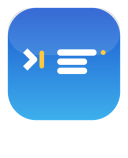

#  CodeLauncher

选好环境，自动在 VS Code 新窗口打开 —— 目录结构、编译与调试配置一次生成，不用再手动建目录、配 `tasks.json`、敲命令。

**适配系统**　macOS（Apple Silicon）｜ Windows

**适配环境**　C ｜ Python

**适配软件**　 Visual Studio Code

## 安装

**下载安装包**（推荐）→ [Releases](https://github.com/Alooshy0827/CodeLauncher/releases/latest)

| 平台 | 文件 |
|---|---|
| macOS（Apple Silicon） | `CodeLauncher-macOS-arm64.zip` |
| Windows | `CodeLauncher-Windows.zip` |

> **macOS**：首次打开需**右键 →「打开」**（应用未签名，双击会被 Gatekeeper 拦下）
>
> **Windows**：解压前先右键压缩包 → 属性 → **解除锁定**，否则 PowerShell 会拒绝执行脚本

**从源码安装**

```bash
# macOS
git clone https://github.com/Alooshy0827/CodeLauncher.git
cd CodeLauncher/macos && ./build.sh --install
cp new-c new-py ~/bin/     # 可选：命令行建项目
```

**Windows**：下载本仓库 → 右键 `windows/install.ps1` → 使用 PowerShell 运行

## 依赖

- [VS Code](https://code.visualstudio.com/)
- C 项目：C 编译器（MinGW / clang / MSVC 自动检测）
- Python 项目：Python 3

## License

[MIT](LICENSE)
